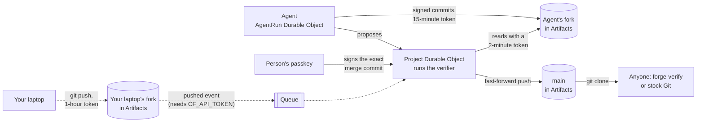

# Open Integrity Forge

> - _did: `did:repo:2a9cbddf5733978a33556e4e6ffc5753e39451b4/blob/main/README.md`_
> - _github: `https://github.com/OpenIntegrityProject/open-integrity-forge/blob/main/README.md`_
> - _updated: 2026-10-23 by Christopher Allen <ChristopherA@LifeWithAlacrity.com>_

[](https://spdx.org/licenses/BSD-2-Clause-Patent.html)
[](https://www.repostatus.org/#concept)
[](https://github.com/OpenIntegrityProject/open-integrity-forge/commit/2a9cbddf5733978a33556e4e6ffc5753e39451b4)

**A Git platform for agents in which the platform cannot make a commit valid.**

Today, an AI agent can create a pull request, run a review, and
trigger a deployment. Every system downstream sees a valid login, but
none of them know: *did a person who is allowed to approve this
actually intend this specific change?* Though the Git platform may be
able to answer the question, that just gives it all the power, and
whoever compromises the platform acquires that power too.

Open Integrity Forge moves that authority out of the platform and into
the repository. Validity lives in Git:

- Every repository starts with a **signed first commit**, its root of trust. Its hash is the repository's id and its decentralized identifier, `did:repo:<hash>`: one address for the repository, the same on every host and in every clone.
- **Files committed in the repository** define the rules for who may sign what, and each commit is judged by the rules in force *before* it, so a key can never authorize itself.
- Agents work **at the same time, each in its own fork**, each signing with its **own key that lasts an hour**. They can write, sign and propose freely. They cannot merge.
- A change reaches `main` only when **a person signs that exact merge commit** with a passkey: both parents, the resulting tree and the message are covered by an ordinary Git SSH signature.
- **Anyone with a clone can check the whole history, on any host, without the forge in the loop.** Cloudflare hosts the repositories and GitHub can mirror them; neither can make a commit valid.

**Video:** [Open Integrity Forge](https://www.youtube.com/watch?v=_KdOGtynXig), a seven-minute walkthrough of the demo

[](https://www.youtube.com/watch?v=_KdOGtynXig)

## Installation Instructions

To run locally, you need Node 23.6 or later and Git. No Cloudflare account is needed: locally, repositories live in Durable Objects that keep the Artifacts contract.

```sh
npm install
npm run dev -w forge          # http://localhost:8787
```

Open http://localhost:8787, register with a passkey and create a project. Browsers allow passkeys on `localhost`. Tests, deployment, and the GitHub mirror are described in [apps/forge/README.md](apps/forge/README.md).

### Check a repository with no forge

The verifier is one file, `forge-verify.mjs`, which each new
repository pins by its SHA-256 digest. "Show the commands" on the page
gives the exact commands with a read-only token that lasts an hour:

```sh
git clone https://<account>.artifacts.cloudflare.net/git/forge-demo/<repo>.git notes
curl -fsSLO https://<forge>/forge-verify.mjs
shasum -a 256 forge-verify.mjs          # must match the digest the repository pins
node forge-verify.mjs notes --repo <the id of the first commit>
```

`--repo` takes the hash in the repository's `did:repo` address, so a clone of any other repository fails, whatever host served it.

The verifier requires Node 22 or later, prints each commit with its rules, and exits 0 when all pass. Git alone checks every signature:

```sh
TZ=UTC git -C notes -c gpg.ssh.allowedSignersFile=.repo/config/verification/allowed_commit_signers log --show-signature
```

Stock Git checks every commit: the agents' commits carry ordinary SSH signatures, and each commit of `main` carries the passkey's signature, listed in `allowed_commit_signers` as the OpenSSH security key it signs with. Run it with `TZ=UTC`, since under daylight saving time, Git on macOS checks a key's window an hour late. `forge-verify` adds the policy of each commit's parent, key windows and revocation, and release approvals (which are not available with Git alone).

### Security in brief

**What an approval proves.** Each commit of `main` carries a WebAuthn assertion as its SSH signature. Anyone can check it from a clone, with `forge-verify` or stock Git, and without the forge. It proves four things:

1. A passkey scoped to this forge's domain made the signature. OpenSSH checks the domain's hash in the signed authenticator data.
2. The signature covers the whole commit: its parents, tree, author and message. The `Forge-Approval` trailer names the repository and ref, so an approval cannot be moved elsewhere.
3. `forge-verify` also requires that the authenticator verified the person with a PIN or biometric. Stock Git cannot require it.
4. The passkey is one the repository's own signer policy lists. Each change to that policy was approved by a promoter, back to the inception commit, whose passkey the first policy names.

**What it does not prove.**

- **Who the person is.** Nothing ties a passkey to a natural person or to another key they hold.
- **What made the key.** Registration asks for no attestation. A passkey may be synced, and is then as safe as the account it syncs through.
- **That the passkey signed what the page showed.** The forge chooses what the passkey signs and serves the page that shows it. An authenticator shows no content.
- **When the commit was made.** The signer writes the time.

[SECURITY.md](SECURITY.md) covers each of these limits and what would
close it. The passkeys come from
[passkey-cloudflare](https://github.com/BlockchainCommons/passkey-cloudflare). Its
[security
model](https://github.com/BlockchainCommons/passkey-cloudflare/blob/main/docs/security-model.md)
explains the bindings a passkey can and cannot prove, and lists
unexplored ways to prove more. Among them are binding a promoter's
passkey to another key they hold, signing enrollments and operator
actions, and deriving keys from a passkey.

### Forge Rules

The policy is stored at `.repo/config/verification/policy.json`. A commit is checked against the policy of its first parent, so it cannot change the rules it obeys.

| Rule | Statement |
| --- | --- |
| R0 | The first commit of `main` is the root of trust. Its approval verifies against the promoter key in its own policy. Its hash is the repository id. |
| R1 | Each later commit of `main` requires an approval from a promoter in the policy of its first parent. |
| R2 | Only a commit of `main` with such an approval can change `.repo/`. A key that a commit adds has no say over that commit. |
| R3 | Each other commit that `main` reaches must carry a valid SSH signature from a key in the policy in force when it came in. |
| R4 | An approval must name this repository, the ref, the parents, and the tree of its own commit. |
| R5 | An author key may sign only inside its validity window. |
| R6 | A key a promoter revoked may sign nothing after its revocation; its earlier work still verifies. |
| R7 | Where the policy says `mergesOnly`, a commit of `main` with one parent changes only `.repo/`, so that no squash will drop the authors' signatures. |
| R8 | A release tag of a `main` commit carries approvals of that tag from as many distinct promoters as `releaseApprovals` requires. |
| M | A proposal merges into `main` with no conflicts (proposals only). |

A promoter approves a change of `main` by signing the commit itself: a
WebAuthn assertion whose challenge is the commit's SSHSIG data, stored
as the commit's SSH signature in OpenSSH's
`webauthn-sk-ecdsa-sha2-nistp256@openssh.com` format. The commit
message ends with a `Forge-Approval` trailer naming the repository,
the ref, the parents, and the tree, which the signature covers. A
release tag carries its approvals in its message instead. Each
approval can also be read as a [Gordian
Envelope](https://developer.blockchaincommons.com/envelope/).

## Related Software

### Libraries in Use

Open Integrity Forge runs on [Cloudflare
Workers](https://developers.cloudflare.com/workers/), [Durable
Objects](https://developers.cloudflare.com/durable-objects/),
[Queues](https://developers.cloudflare.com/queues/) and
[Artifacts](https://developers.cloudflare.com/artifacts/). Its
sign-in, account settings and passkey approvals are built on
[passkey-cloudflare](https://github.com/BlockchainCommons/passkey-cloudflare),
Blockchain Commons' passkey-only identity library for Workers and
Durable Objects. `packages/passkey-cloudflare` and `apps/demo` here
carry its code as of upstream commit
[61942af](https://github.com/BlockchainCommons/passkey-cloudflare/commit/61942af42eb003e631521461d9f3f236d98e0436),
which offers ES256 first at registration
([BlockchainCommons/passkey-cloudflare#20](https://github.com/BlockchainCommons/passkey-cloudflare/pull/20)),
since only a P-256 passkey can make the SSH signature Git checks. It
is part of the [Open Integrity
Project](https://github.com/OpenIntegrityProject), a [Blockchain
Commons](https://www.blockchaincommons.com) project, which describes
the forge on its [developer
site](https://developer.blockchaincommons.com/open-integrity/forge/).

### Cloudflare Usage

| Product | What it does in the forge | Code |
| --- | --- | --- |
| Artifacts | One repository for each project, and a fork of it for each agent and for a person who pushes from a laptop. Write tokens reach one fork only: an agent's lasts 15 minutes and a laptop's an hour. The forge reads forks and writes `main` with tokens that last two minutes, and "Show the commands" hands out a read-only token that lasts an hour. Artifacts accepts a push only as a fast-forward. | `apps/forge/src/repo-host.ts` |
| Durable Objects | `Project` holds a project's state, checks each proposal with the verifier, and writes `main` only with a verified approval. `AgentRun` runs one agent's tasks from an alarm. `Person` keeps a person's promoter key and projects, and `RepoIndex` finds the project a repository belongs to. The passkey-cloudflare library adds Durable Objects of its own for identity records, credentials, member names, challenges, rate limits and the operator log. | `apps/forge/src/project.ts`, `agent-run.ts`, `person.ts`, `repo-index.ts` |
| Workers | One Worker serves the routes and the page and consumes the queue. Git runs in memory with isomorphic-git. The verifier in `apps/forge/authority/` depends on no platform: the same code runs in Workers, Node and Bun. | `apps/forge/src/forge.ts`, `apps/forge/authority/` |
| Queues | Receives Artifacts `pushed` events, so the forge checks a push it did not make, such as one from a laptop. Artifacts sends them only to a subscription for one repository, made through the Cloudflare API with `CF_API_TOKEN`. The live demo leaves that token off, so it does not hear laptop pushes. | `apps/forge/src/events.ts`, `subscriptions.ts` |



[Notes for Cloudflare](docs/notes-for-cloudflare.md) records what would help an app like this one: a push subscription for a whole namespace, or one the `ARTIFACTS` binding can make, and a look at Durable Object and Artifacts calls that waited 13 to 26 seconds while using almost no CPU.

### Demos & Applications

**Live demo:** [https://forgedemo.gordianstack.com](https://forgedemo.gordianstack.com) (sign in with a passkey, then "Play the story")

#### What the Demo Shows

1. **Your passkey signs the first commit.** It is an empty inception commit, and its hash becomes the repository's id. The next commit, which your passkey also approves, sets the rules and names your passkey as the only promoter.
2. **You admit two agents, Ada and Bo.** Each gets an Ed25519 SSH key that lasts an hour and a fork of its own, with a write token for that fork only. Changing the rules needs your approval too.
3. **The agents work at the same time.** Each signs its commits with its own key and proposes them, and the forge checks every proposal against the rules in the repository.
4. **Bo tries to make its own key a promoter.** The commit is validly signed, but the repository still rejects it: a key can never authorize itself.
5. **You promote Ada's change.** Your passkey signs the merge commit, and `git verify-commit` checks that signature.
6. **Anyone can check it anywhere.** A fresh clone on a laptop, or a mirror on any Git host, gives the same answer.

"Play the story" stops wherever your passkey is needed and picks up from the furthest step the project has done, even after a reload. At its end, "Keep going" plays the rest of the video's tour: two agents conflict and the second redoes its change, a release, a key revoked, and an approval opened as a Gordian Envelope.

The demo also lets you revoke an agent's key, release `main` as a tag that carries your approval, make two agents conflict and redo the loser on the new `main`, and delete a project. Two features need a deployment setting that the live demo leaves off: pushing signed work from your own laptop needs `CF_API_TOKEN` (see [How it uses Cloudflare](#how-it-uses-cloudflare)), and asking an agent to write a note with Claude needs an Anthropic API key. Every change is checked by the same rules. Settings holds your passkeys, recovery codes and sessions, and, for an operator, tools to look up, suspend or help a member recover, and to list and delete any project.

## Status - Alpha

Open Integrity Forge is a concept, on hold while it waits for
feedback. Nothing is wrong with it: the live demo stays up, works as
described here, and gets security fixes and library updates, but no
new features are planned until feedback shows what should come
next. It is a proof of concept. It does not update Open Integrity's
specifications and is not a reference implementation. Blockchain
Commons continues to work in this area, including on
[passkey-cloudflare](https://github.com/BlockchainCommons/passkey-cloudflare),
the passkey library this forge and future Blockchain Commons projects
use.

### What This Does Not Do

- **The verifier of an Open Integrity repository, such as [oi-demo](https://github.com/OpenIntegrityProject/oi-demo), does not yet pass a repository the forge creates.** The forge keeps its rules in `policy.json` and generates `allowed_commit_signers` from it, but not `allowed_main_signers` or `allowed_tag_signers`; writing those from the policy is the next step.
- **A release approval binds the repository, ref, commit and tree, not the tag message.** A commit of `main` is signed as a whole, message and author included.
- **One promoter per project.** The policy and the verifier accept several, as well as releases that need more than one approval; the page collects one approval per change.
- **The agents are scripted**, so the demo runs the same way each time. A deployment with an Anthropic API key can have an agent write one note with Claude. A signature proves which key signed, not which model produced the change.

## Financial Support

This is a project of [Blockchain Commons](https://www.blockchaincommons.com/). We are proudly a "not-for-profit" social benefit corporation committed to open source & open development. Our work is funded entirely by donations and collaborative partnerships with people like you. Every contribution will be spent on building open tools, technologies, and techniques that sustain and advance blockchain and internet security infrastructure and promote an open web.

To financially support further development of this and other projects, please consider becoming a Patron of Blockchain Commons through ongoing monthly patronage as a [GitHub Sponsor](https://github.com/sponsors/BlockchainCommons). You can also support Blockchain Commons with bitcoins at our [BTCPay Server](https://btcpay.blockchaincommons.com/).

## Contributing

We encourage public contributions through issues and pull requests! Please review [CONTRIBUTING.md](./CONTRIBUTING.md) for details on our development process. All contributions to this repository require a GPG signed [Contributor License Agreement](./CLA.md).

### Discussions

The best place to talk about Blockchain Commons and its projects is in our GitHub Discussions areas:

- [**Gordian Developer Community**](https://github.com/BlockchainCommons/Gordian-Developer-Community/discussions): For developers working with Gordian specifications.
- [**Gordian User Community**](https://github.com/BlockchainCommons/Gordian/discussions): For users of the Gordian reference apps.
- [**Blockchain Commons Discussions**](https://github.com/BlockchainCommons/Community/discussions): For developers, interns, and patrons of Blockchain Commons, to talk about general Blockchain Commons issues, the intern program, or topics other than those covered by the other two areas.

### Other Questions & Problems

As an open-source, open-development community, Blockchain Commons does not have the resources to provide direct support of our projects. Please consider the discussions area as a locale where you might get answers to questions. Alternatively, please use this repository's [issues](https://github.com/BlockchainCommons/passkey-cloudflare/issues) feature. Unfortunately, we can not make any promises on response time.

If your company requires support to use our projects, please feel free to contact us directly about options. We may be able to offer you a contract for support from one of our contributors, or we might be able to point you to another entity who can offer the contractual support that you need.

## Credits

The following people directly contributed to this repository. You can add your name here by getting involved. The first step is learning how to contribute from our [CONTRIBUTING.md](./CONTRIBUTING.md) documentation.

- **Christopher Allen** ([@ChristopherA](https://github.com/ChristopherA)), Blockchain Commons: architect of Open Integrity and of this forge; author of [passkey-cloudflare](https://github.com/BlockchainCommons/passkey-cloudflare) ([overview](https://developer.blockchaincommons.com/cloudflare-passkey/)), the passkey-only identity library the forge's sign-in and approvals are built on, and of the forge's passkey-signed inception commits and commits of main.
- **Leonardo Custodio** ([@leonardocustodio](https://github.com/leonardocustodio)): built the forge demo, its verifier, its page and its tests.

Commits are signed with SSH keys. Christopher Allen's current SSH signing keys are listed at <https://api.github.com/users/ChristopherA/ssh_signing_keys>.

## Responsible Disclosure

We want to keep all of our software safe for everyone. If you have discovered a security vulnerability, we appreciate your help in disclosing it to us in a responsible manner. We are unfortunately not able to offer bug bounties at this time.

We do ask that you offer us good faith and use best efforts not to leak information or harm any user, their data, or our developer community. Please give us a reasonable amount of time to fix the issue before you publish it. Do not defraud our users or us in the process of discovery. We promise not to bring legal action against researchers who point out a problem provided they do their best to follow these guidelines.

### Reporting a Vulnerability

Please report suspected security vulnerabilities in private via email to ChristopherA@BlockchainCommons.com (do not use this email for support). Please do NOT create publicly viewable issues for suspected security vulnerabilities.

The following keys may be used to communicate sensitive information to developers:

| Name              | Fingerprint                                        |
| ----------------- | -------------------------------------------------- |
| Christopher Allen | FDFE 14A5 4ECB 30FC 5D22  74EF F8D3 6C91 3574 05ED |

You can import a key by running the following command with that individual's fingerprint: `gpg --recv-keys "<fingerprint>"` Ensure that you put quotes around fingerprints that contain spaces.

## License

Unless otherwise noted (either in this [/README.md](./README.md) or in
the file's header comments) the contents of this repository are
Copyright © 2026 by Blockchain Commons, LLC, and are
[licensed](./LICENSE) under the [spdx:BSD-2-Clause Plus Patent
License](https://spdx.org/licenses/BSD-2-Clause-Patent.html).
